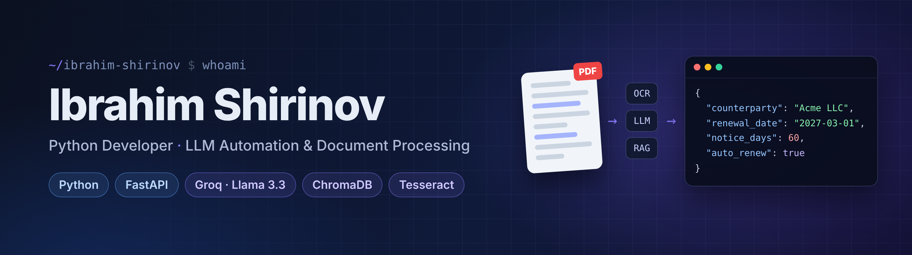

# Ibrahim Shirinov

### Python Developer | AI Automation | Software Engineering

*Building intelligent systems. Automating workflows. Solving real-world problems.*

---

## About Me

I'm a developer focused on Python, AI-powered applications, and intelligent automation.

I enjoy building practical software that solves real-world problems, particularly in document processing, information retrieval, and business workflow automation.

- Developing AI-powered applications and automation systems.
- Exploring LLMs, RAG architectures, and semantic search.
- Building document processing and OCR solutions.
- Continuously improving my backend engineering skills.

---

## Tech Stack

**Languages & Backend**

**AI & Data**

**Tools**

---

## Areas of Interest

- AI & LLM Applications
- Intelligent Document Processing
- Retrieval-Augmented Generation (RAG)
- Business Process Automation
- Backend Engineering
- Semantic & Hybrid Search

---

## Current Focus

Building practical AI applications, improving backend development skills, and exploring scalable automation solutions.

---

## GitHub Statistics

---

### BUILD / AUTOMATE / IMPROVE

*Always learning. Always building.*

